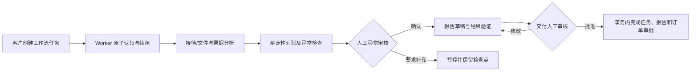

# LedgerCrew 生产基础改造交付报告（2026-11-07）

> 下文第 1–9 节记录第一轮交付时点。第二轮增量结果见第 10 节；第一轮的测试数字、迁移 head 和待办描述仅是历史基线。

本报告以仓库实际代码和测试为准。修改前 Python 3.11 基线为 **209 passed / 79.37s**；原始用户说明中的 120 个测试与当前仓库不符。完整问题清单、调用链和迁移依赖见 [审计报告](PRODUCTION_AUDIT_2026-11-07.md)。以下是增量改造结果，不等于真实客户生产环境验收。

## 1. 架构前后对比

| 领域 | 改造前 | 当前实现与边界 |
| --- | --- | --- |
| 身份 | 开发模拟 `X-User-Id`；生产认证关闭 | 生产本地用户名/密码、scrypt 哈希、数据库会话、HttpOnly/Secure/SameSite Cookie、CSRF、过期/撤销/锁定；开发测试仍兼容模拟身份 |
| 租户 | Studio 所有者为主要访问边界 | 增加用户与 Studio 成员关系；订单、文件、报告、反馈和支付入口按 Studio 校验；全局 owner 角色显式保留 |
| 收费 | 订单含模拟标识，价格规则不足 | 订单快照来自配置的金额/币种；Sandbox Provider、签名回调、幂等状态转换和记录；没有真实扣款/结算 |
| Agent | 独立 MiMo/MAF 合成样例与业务任务协议分离 | 后端单任务 `MiMoAgentGateway` 复用 MiMoRunner，预算/用量入库，单进程执行脚本；完整多节点工作流仍独立，真实服务未验证 |
| 任务 | 队列/运行/暂停/完成/失败 | 增取消、超时、有限重试、历史、人工结果审核/重分析入队；缺持久 Worker 租约、心跳和多进程安全调度 |
| 交付 | 报告发布可直接驱动 delivered | 有价格订单需发布报告和成功的对应支付记录才可标记交付；Sandbox 记录不证明真实客户已付款或收到报告 |
| 运维 | `/health` 仅存活 | `/health/live`、`/health/ready`、数据库迁移/队列检查、真实依赖未验收时 503；SQLite 快照备份/恢复脚本沿用并补文档 |

## 2. 分阶段完成情况

1. **审计和基线**：审查路由、模型、迁移、权限、文件/ZIP、Worker、MiMo、报告、前端、CI 与文档；记录原有全量测试、Ruff 和 OpenAPI 实况。
2. **P0 身份/隔离/运维**：实现本地生产账号、会话、CSRF、角色和成员授权；新增健康检查、审计记录；未迁移现有业务库。
3. **订单/支付/恢复**：金额与币种显式配置、Sandbox 支付状态机与报告交付门禁；任务取消、重试、超时、历史。
4. **AI/人工/反馈**：后端单任务 MiMo 适配、模型请求预算、用量记录；结果确认/纠错/驳回与历史、客户反馈及处理记录。完整多 Agent 工作流后端接入仍在待办。
5. **容量/工程治理**：请求与 ZIP 累计限额、进程内 API/SSE 限流；全 app/scripts/tests Ruff、CI pytest/Alembic 检查、API 与运维文档。

## 3. 数据库迁移

Alembic 单 head `0014_agent_model_artifacts`。`0009` 创建用户、服务端会话、Studio 成员；`0010` 加订单币种和 Sandbox 支付意图/事件/对账；`0011` 加反馈/处理历史；`0012` 加 Agent 结果审核；`0013` 扩展任务状态、尝试次数和状态历史；`0014` 加任务模型请求预算和非内容遥测。仅在隔离 SQLite 测试库执行 `upgrade head` 与 `alembic check`，未对 `server/ledgercrew.db` 执行迁移。具体备份、升级、回退限制见 [数据库迁移手册](DATABASE_MIGRATION.md)。

## 4. API 与权限

OpenAPI 当前 46 条路径、54 个操作。新增登录/注销/当前用户的生产 Cookie 流程，支付意图与 Sandbox Webhook、客户反馈、Agent 结果审核与统计、任务查询/历史/取消/重试、`/health/live` 与 `/health/ready`。请求/响应字段、权限、错误码和示例见 [API 文档](API.md)。客户对象使用 Studio 授权，owner 执行管理操作；Sandbox 回调使用 HMAC 原始请求体签名。开发测试的模拟头在生产配置下不被信任。

## 5. 配置和运行

新增或需明确配置的变量：`ENVIRONMENT`、`DATABASE_URL`、`STORAGE_ROOT`、`AUTH_SESSION_TTL_SECONDS`、`AUTH_MAX_FAILED_ATTEMPTS`、`AUTH_LOCK_SECONDS`、`SERVICE_PRICES_CENTS`、`SERVICE_CURRENCY`、`PAYMENT_SANDBOX_WEBHOOK_SECRET`、`WORKER_MAX_ATTEMPTS`、`WORKER_TIMEOUT_SECONDS`、`API_RATE_LIMIT_REQUESTS`、`API_RATE_LIMIT_WINDOW_SECONDS`、`SSE_MAX_CONNECTIONS`、`MAX_UPLOAD_REQUEST_BYTES`、`MAX_ORDER_ARCHIVE_BYTES`、`MAX_ORDER_EXTRACTED_BYTES`，以及现有 `MIMO_*` 变量。示例和默认值见 [server/.env.example](../server/.env.example)。价格、币种和真实支付商尚未确定，默认不创建支付意图。生产账号使用 [create_user.py](../server/scripts/create_user.py) 显式开通；单任务执行可用 [run_agent_tasks.py](../server/scripts/run_agent_tasks.py)，当前 SQLite 仅允许单个执行进程。

## 6. 测试、质量与 CI

- 修改前：Python 3.11 **209 passed / 79.37s**；旧 Ruff 全 app 108 项问题。
- 修改后：Python 3.11 **226 passed / 113.28s**；迁移 `upgrade head` / `alembic check` 在独立数据库通过，`ruff check app scripts tests` 与 contracts 检查通过，`git diff --check` 无空白错误。新测试覆盖登录/CSRF/租户、支付回调/退款/幂等、反馈、人工审核、任务恢复、上传限额、健康检查、进程内限流和后端 MiMo 单任务调用。
- 本地没有已安装并锁定的覆盖率工具，**不报告新的覆盖率百分比**，CI 尚未在 GitHub Actions 上实际运行。CI 配置已加入完整 pytest、Ruff、编译、Alembic upgrade/check；覆盖率门槛仍在待办。

## 7. 修改文件清单

仓库根与文档：`.github/workflows/agents.yml`、`README.md`、`docs/AI_INTEGRATION.md`、`docs/API.md`、`docs/DATABASE_MIGRATION.md`、`docs/DEPLOYMENT.md`、`docs/FRONTEND.md`、`docs/P2_DECISIONS.md`、`server/docs/DELIVERY.md`、`server/README.md`、`server/.env.example`、`server/pyproject.toml`。

后端：`server/app/api/v1/endpoints/{auth,events}.py`、`server/app/api/v1/router.py`、`server/app/core/{config,security}.py`、`server/app/db/types.py`、`server/app/integrations/agents/contracts.py`、`server/app/main.py`、`server/app/models/{__init__,delivery,reconciliation,records,transactions}.py`、`server/app/repositories/reconciliation.py`、`server/app/schemas/{agent,auth}.py`、`server/app/services/{access,agent_service,auth_service,csv_service,export_service,file_service,order_service,order_state,reconciliation_service,report_service,studio_service}.py`。

既有测试调整：`server/tests/{test_auth,test_foundation,test_migration_safety,test_stage2,test_stage4,test_stage5,test_stage6,test_stage7_e2e}.py`。另 `server/tests/test_backup_restore.py` 原有测试通过共享 head 常量跟随新迁移，无需修改。

工作区还存在 `docs/BE2_10_TEST_REPORT.md`、`docs/V2_ACCEPTANCE_CHECKLIST.md` 的其他修改及未跟踪 `docs/BE2_10_13_FINAL_ACCEPTANCE.md`；不属于本次交付，未将其内容计入上述结果。

## 8. 新增文件清单

文档：`docs/BACKLOG.md`、`docs/LIVE_INTEGRATION.md`、`docs/PRODUCTION_AUDIT_2026-11-07.md`、本报告。

迁移：`server/alembic/versions/{0009_local_identity,0010_sandbox_payments,0011_feedback,0012_agent_result_review,0013_task_recovery,0014_agent_model_artifacts}.py`。

后端：`server/app/api/v1/endpoints/{agent_reviews,feedback,payments,worker_tasks}.py`、`server/app/core/limits.py`、`server/app/integrations/agents/mimo_gateway.py`、`server/app/models/{agent_model_artifact,agent_review,feedback,identity,payment,task_history}.py`、`server/app/schemas/{agent_review,feedback,payment}.py`、`server/app/services/{agent_review_service,feedback_service,health_service,local_auth,payment_service}.py`、`server/scripts/{create_user,recover_tasks,run_agent_tasks}.py`。

测试：`server/tests/{test_agent_reviews,test_feedback,test_health_ready,test_limits,test_mimo_gateway,test_payment_sandbox,test_upload_quotas,test_worker_recovery}.py`。

## 9. 外部依赖、未验证事项与下一步

仍需业务决定：价格和币种规则、正式支付供应商与退款审批；用户已明确当前只做 Sandbox。仍需外部配置：生产账号、HTTPS 反向代理、MiMo 密钥及真实服务、生产数据存储和备份。真实模型、真实支付、真实客户浏览器 Cookie/CSRF、跨实例限流、Worker 多进程租约/心跳、SQLite 压力和备份恢复演练均未通过真实环境验收。`/health/ready` 的 503 是刻意保留的准确状态。

下一阶段优先将完整 MAF 工作流接入正式数据库/文件适配器，建设有租约和心跳的 Worker，完成隔离环境真实 MiMo 联调；随后确认 DEC-015 价格/支付商并接正式结算对账，最后做公网安全、并发/备份、前端闭环验收。详见 [待办清单](BACKLOG.md) 与 [真实环境联调边界](LIVE_INTEGRATION.md)。

## 10. 第二轮增量：MiMo、完整 MAF 工作流与 Worker

本轮复用 `MiMoRunner` 和已有 MAF `WorkflowBuilder` 图，没有替换模型运行器或支付边界。后端业务数据适配器把订单、已验证票据、流水和确定性对账结果送入现有结构化 Agent 契约；Worker 执行整图，人工审核经服务端检查点暂停与恢复。报告版本关联实际对账批次和工作流任务，最终任务、报告、订单审批在同一事务中提交。

### 模型请求与预算

`TaskModelArtifacts` 用 SQLite `BEGIN IMMEDIATE` 串行化跨进程预算预留；每次请求写入请求历史，响应钩子记录 HTTP 状态、耗时、模型和供应商返回的 Token 用量。结算以唯一 `model_settlement` 工件保护，重复结算只接受首个结果。供应商不返回用量时标记 `usage_status=unknown`，不推算 Token。限流、服务不可用、超时和网络错误分类后进行有限重试；解析与 Schema 验证失败会使任务失败，不写入成功业务结果。请求失败仍占用请求次数，未知 Token 不作数值扣减。凭证不存在，真实 MiMo HTTP 调用**未执行**；模拟响应契约测试不代表外部服务通过。

### 工作流状态、检查点与人工审核

`full_workflow` 使用 `supervisor` 任务契约和现有五节点 MAF 图；任务状态 `queued → running → paused → retrying → running → succeeded`，错误可进入 `failed/timeout`。`FileCheckpointStorage` 存每次关键暂停的图快照，`AgentRun.checkpoint_data` 存 checkpoint ID、审核请求、回复和报告 ID；恢复时核对最新 checkpoint 与结构化 `HumanReply`。数据库工件保存已完成步骤的必要结果，报告/对账记录附任务来源并复用稳定 ID，防止常见重试重复写入。检查点缺失或不匹配明确失败。审核请求、操作者、时间和版本写入现有审核/任务历史；报告人工审批只能经工作流回复完成。文件检查点与数据库需一致备份；文件写入与数据库提交之间仍有崩溃窗口，不能承诺外部模型调用严格一次。

### Worker 租约、失败恢复与就绪

每个 Worker 持久化唯一 ID、启动/心跳/停止时间和当前任务。认领用数据库条件更新完成竞争控制；任务保存 `lease_owner`、过期时间、递增 `lease_generation`。执行前后检查持有者和代数，后台心跳续租；旧 Worker 的迟到结果被拒绝。过期租约回收后按次数上限和指数退避重试，失败原因与状态变更写入历史；信号停机尝试放弃在途任务并安全释放租约。`/health/live` 仅检查 API；`/health/ready` 检查迁移、队列、活跃心跳、工作流组件和 MiMo 配置，并把未验证外部服务如实报告为 503。配置了密钥不等于服务可达。

### 迁移、API 与文件

新增 `0015_worker_leases`（Worker 实例、任务租约/索引）和 `0016_workflow_provenance`（票据、对账、报告的工作流来源/版本）。隔离 SQLite 数据库完成空库升级及 Alembic schema 检查。**验证过程中曾误迁移工作区默认 `server/ledgercrew.db` 从 `0004` 到 `0016`**：只读核查显示所有业务表为空、完整性正常；没有降级、覆盖或删除，需负责人决定其后续处置。详见 [事件记录](DATABASE_MIGRATION.md)。新增 `POST /api/v1/orders/{order_id}/workflows`、`GET /api/v1/agent-tasks/{task_id}/workflow-review`、`POST /api/v1/agent-tasks/{task_id}/workflow-reply`；详见 [API](API.md)。核心新增文件为 `server/app/integrations/agents/{workflow_backend,workflow_gateway}.py`、`server/app/services/{workflow_service,worker_service}.py`、`server/app/models/worker.py`、`server/app/schemas/workflow.py`、`server/app/api/v1/endpoints/workflows.py`、`server/scripts/verify_backend_mimo.py`、上述两项迁移及 `server/tests/{test_full_workflow_backend,test_worker_leases,test_live_entry}.py`；预算、运行器、任务/报告/对账、Worker 脚本、健康检查及相关文档为修改文件。支付系统本轮未改动。

### 验证与剩余条件

修改前基线 **226 passed**。第二轮 Python 3.11 全量 **232 passed / 137.26s**；Ruff 全 app/scripts/tests 与 contracts、Python 编译检查通过；隔离库 `alembic upgrade head`、空库 `0016→0014→0016` 往返和 `alembic check` 通过。GitHub Actions 尚未远程运行。已在隔离数据库验证完整 MAF 图经 Worker 执行、人工暂停恢复和报告审批；真实 MiMo 凭证缺失，独立 `verify_backend_mimo.py` 入口未运行。下一步需要真实 `MIMO_API_KEY` 和受控网络出口，在隔离环境显式执行 [联调步骤](LIVE_INTEGRATION.md)，并留存脱敏 HTTP/预算证据；随后验证真实浏览器、反向代理、持久共享存储与异常恢复演练。客户资料补充后重做输入快照的修订流程、跨存储原子补偿与多实例压力验证仍待完成，不能据此宣布生产验收。
